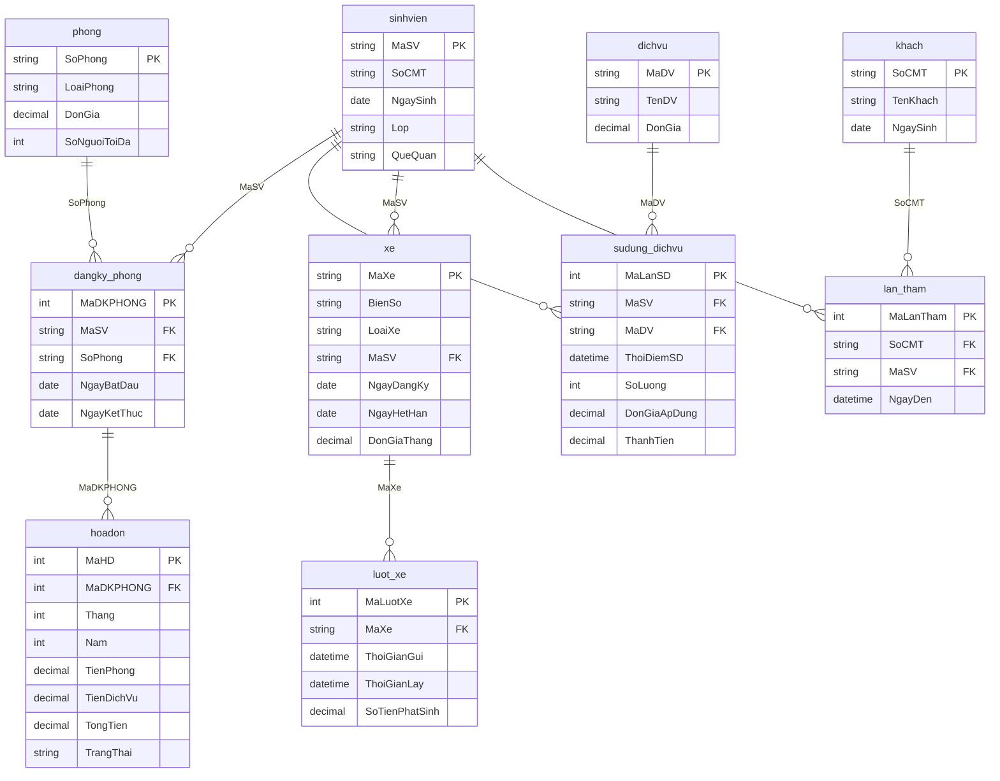

# HỆ THỐNG QUẢN LÝ KÝ TÚC XÁ SINH VIÊN

Ứng dụng Desktop chuyên nghiệp quản lý toàn diện Ký túc xá sinh viên bằng Python (Tkinter) và CSDL SQLite, được xây dựng chính xác theo sơ đồ cơ sở dữ liệu quan hệ gồm **10 bảng**:

1. `sinhvien`: Hồ sơ sinh viên nội trú.
2. `phong`: Danh mục phòng ký túc xá, loại phòng, đơn giá, sức chứa.
3. `dangky_phong`: Xếp phòng sinh viên, ngày bắt đầu, ngày kết thúc.
4. `hoadon`: Hoá đơn thanh toán tiền phòng & dịch vụ hàng tháng.
5. `dichvu`: Danh mục dịch vụ (giặt ủi, nước uống, wifi, gym...).
6. `sudung_dichvu`: Ghi nhận sinh viên sử dụng dịch vụ & tính thành tiền.
7. `xe`: Đăng ký xe vé tháng của sinh viên.
8. `luot_xe`: Lịch sử kiểm soát lượt xe ra / vào cổng KTX.
9. `khach`: Thông tin khách đến thăm sinh viên.
10. `lan_tham`: Ghi nhận thời điểm khách đến thăm sinh viên.

---

## 🏛️ Sơ Đồ Cơ Sở Dữ Liệu SQL (ERD)



---

## 🔑 Hướng Dẫn Đăng Nhập

Hệ thống tự động xác định vai trò đăng nhập dựa trên tài khoản nhập mặc định vào:

Tài khoản quản trị viên		Tên : admin		    Password : 123456

Tài khoản quản lí KTX		Tên : quanli1		Password : 123456

Tài khoản sinh viên		    Tên : mã căn cước	Password : 123456

Tài khoản quản trị viên có quyền thêm/sửa/xóa các tài khoaản quản lí.a

---

## 🚀 Cách Chạy Ứng Dụng

Mở Terminal hoặc Command Prompt tại **thư mục gốc của dự án** và chạy lệnh:

```bash
python main.py
```
*(Hoặc `python3 main.py` tùy thuộc vào phiên bản cài đặt trên máy của bạn).*
